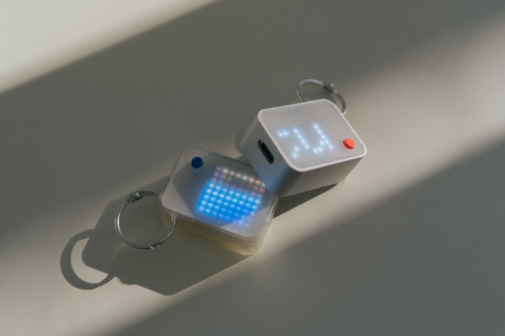

# turnie v1.5

Waveshare **ESP32-S3-Matrix**（8x8 LED）に自作のシールド基板を重ねた turnie。
すれ違った turnie どうしで、BLE5 拡張アドバタイズを使ってピクセルアートや文字を交換する。
基板、筐体（HP MJF PA12 ＋ アクリルの天板）、ファームウェアをまとめたリポジトリ。

## ディレクトリ構成

| ディレクトリ | 内容 |
|---|---|
| `hardware/` | KiCad プロジェクト（シールド基板 r2）、BOM、ガーバー（`production/`）、回路図 PDF（`out_20261115/`） |
| `enclosure/case_r2_20261120/` | 筐体 r2（STEP と、生成・干渉確認用の CadQuery スクリプト） |
| `enclosure/fdm_20261119/` | FDM 試作用の筐体（STEP、STL、スクリプト） |
| `firmware/` | ファームウェア（PlatformIO、ESP32-S3）。通信仕様は `firmware/COMMUNICATION_SPEC.md` |

## ハードウェア

| 部品 | 内容 |
|---|---|
| MCU / LED | Waveshare ESP32-S3-Matrix（8x8 WS2812B、IMU QMI8658） |
| 充電 | MCP73831（USB-C はモジュールの受け口を使う） |
| 電源 | SW2 スライドスイッチ ＋ SW1 で入る電源ラッチ（Q1 P-FET、IO2 で保持） |
| ボタン SW1 | 一般的な 6x6 mm タクトスイッチ（高さ 5 mm）＋ 3D プリントのキャップ |
| 電池 | LiPo 36 x 24.5 x 5.6 mm |
| 筐体 | 42.99 x 30.93 x 17.60 mm、HP MJF PA12、天板はアクリル 2.0 mm |

## 関連リポジトリ

- [turnie_device_v1.5](https://github.com/turn-ie/turnie_device_v1.5)：v1.5 のファームウェア（このリポジトリの `firmware/` は r2 基板向けの版）
- [turnie_app](https://github.com/turn-ie/turnie_app)：iOS アプリ
- [turnie_garber](https://github.com/turn-ie/turnie_garber)：初期のシールド基板のガーバー
